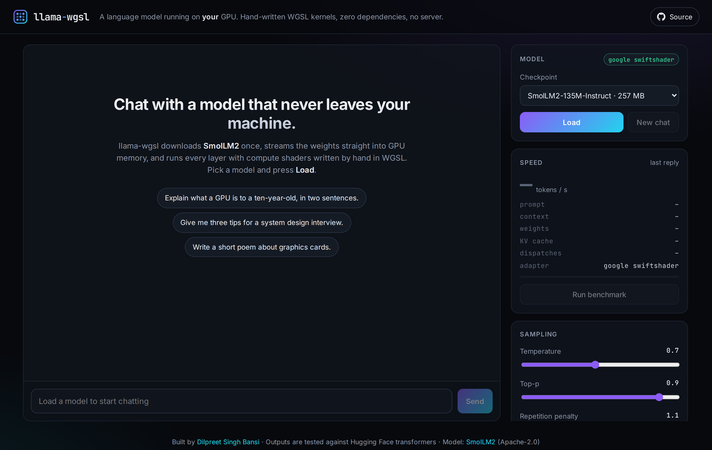
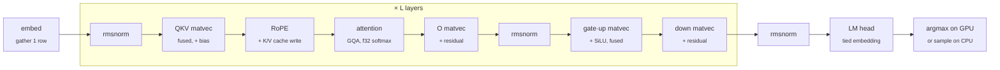

<p align="center"></p>

<h1 align="center">llama-wgsl</h1>

<p align="center"><b>Run a language model on your GPU, in the browser, with compute shaders written by hand in WGSL.</b><br>
No server, no WebAssembly, no ML framework, no runtime dependencies.</p>

<p align="center">
  <a href="https://dilpreetbansi.github.io/llama-wgsl/"><b>Live demo</b></a> ·
  <a href="#how-it-works">How it works</a> ·
  <a href="#correctness">Correctness</a> ·
  <a href="#run-it-locally">Run locally</a>
</p>

<p align="center"></p>

llama-wgsl loads a Hugging Face checkpoint ([SmolLM2](https://huggingface.co/collections/HuggingFaceTB/smollm2-6723884218bcda64b34d7db9) 135M / 360M / 1.7B, or another single-file Llama- or Qwen2-architecture safetensors checkpoint), streams the weights straight into GPU memory, and generates text with its own WGSL kernels. The whole engine (loader, tokenizer, kernels, sampler, chat) is about 1,500 lines of plain JavaScript modules.

It is tested against Hugging Face `transformers`: on SmolLM2-135M-Instruct the logits agree to within 4.8e-5 and a 32-token greedy continuation is identical, token for token.

## How it works

Each generated token is one command buffer holding one compute pass. For a model with *L* layers that pass has 8 *L* + 3 dispatches (243 for SmolLM2-135M):



The parts worth reading:

| | |
|---|---|
| **bf16 without `shader-f16`** | Weights stay in their checkpoint dtype. bf16 values are packed two per `u32` and widened to f32 in registers with a shift and a mask (`bitcast<f32>(w << 16)`, `bitcast<f32>(w & 0xffff0000)`), so they take half the memory and bandwidth of f32 and work on every WebGPU device. f16 checkpoints use `unpack2x16float`; f32 is read directly. [`src/kernels.js`](src/kernels.js) |
| **Matrix-vector kernels** | 256-thread workgroups where 4 to 32 threads (chosen from the inner dimension) cooperate on one row with 16-byte loads, then a shared-memory tree reduction. The Q, K and V projections run as one matvec over concatenated weights; gate and up run together and apply SiLU in the epilogue; the O and down projections add into the residual stream directly. |
| **Attention** | One workgroup per query head. Scores, max, exp-sum and the weighted sum of V happen in one kernel; grouped-query heads index their shared KV head. RoPE uses cos/sin tables computed on the CPU exactly the way `transformers` computes them in f32, which is why long contexts stay in agreement. |
| **Streaming loader** | [`src/safetensors.js`](src/safetensors.js) parses the header from the first bytes of the download and hands each tensor to the GPU as soon as it is complete, so the JavaScript heap never holds the whole checkpoint. The response is tee'd into Cache Storage, so the second visit loads from disk. |
| **No round trips during prefill** | Prompt tokens are queued back to back (a uniform write and a submit each); only the last one reads logits back. Greedy decoding reads back 4 bytes (a GPU argmax) instead of the 196 KB logits vector. |
| **Prefix caching** | The engine remembers which tokens are in the KV cache. A chat turn only computes the tokens after the longest shared prefix, so follow-up questions do not re-run the conversation. |

## Correctness

Everything numeric is checked against an independent reference. `npm run test:gpu` (kernels and tiny checkpoints) runs in CI on every push; the SmolLM2 check needs the 257 MiB checkpoint, so it is opt-in (`npm run test:smollm`).

| Check | Result |
|---|---|
| SmolLM2-135M-Instruct, logits after a 47-token chat prompt vs `transformers` (f32) | max abs difference **4.8e-5** (logits span −6.4 to 31.9) |
| SmolLM2-135M-Instruct, 32-token greedy continuation | **32 / 32** tokens identical |
| Tiny random checkpoints: bf16 + tied embeddings + GQA, f32 + untied head + o_proj bias, Qwen2 f16 + q/k/v biases | max abs difference ≤ **5.3e-6** at all 48 positions, **24 / 24** greedy tokens identical |
| Prefix-cached prefill (shrink, then grow the prompt) | same logits as recomputing from scratch |
| Every WGSL kernel vs a float64 CPU reference (3 dtypes, 5 row widths, 2D grids, GQA shapes, T > workgroup size) | 30 tests |
| Tokenizer vs Hugging Face `tokenizers` | 20 / 20 strings identical; streaming decode reassembles split UTF-8 |

The tests caught real bugs while this was built, for example `transformers` v5 moving `rope_theta` into `rope_parameters`, which silently changed the RoPE base for Qwen2 until the parity test failed at position 1.

## Performance

Decoding one token reads every weight once, so the ceiling is memory bandwidth: SmolLM2-135M in bf16 is 257 MiB of weights, which bounds decoding at roughly 370 tokens/s on a GPU with 100 GB/s of bandwidth. Press **Run benchmark** in the demo to measure your machine (64-token prompt, 128 greedy tokens); it prints a line you can paste into an issue.

CI runs the GPU tests on SwiftShader, a CPU implementation of Vulkan. It is thousands of times slower than a real GPU, so CI timings say nothing about real-world speed.

## Run it locally

```bash
git clone https://github.com/DilpreetBansi/llama-wgsl && cd llama-wgsl
npm run serve        # http://localhost:8080 (no install, no build step)
```

Use a browser with WebGPU: Chrome or Edge 113+, Safari 26+, or Firefox 141+ on Windows. Append `?model=SmolLM2-360M-Instruct` to pick a model, or `?base=/path/to/dir` to load a local directory that serves `config.json`, `tokenizer.json` and `model.safetensors`.

### Use it as a library

```js
import { createDevice, loadModel, hubBase, ChatSession } from './src/index.js';

const { device } = await createDevice();
const { model, tokenizer } = await loadModel(hubBase('HuggingFaceTB/SmolLM2-135M-Instruct'), { device });
const chat = new ChatSession(model, tokenizer, { system: 'You are a concise assistant.' });
for await (const { text } of chat.send('What is a KV cache?', { temperature: 0.7 })) output.append(text);
```

## Tests

```bash
npm install                  # Playwright, used only by the test runner
npm run test:unit            # tokenizer, sampler, streaming safetensors, chat template (Node)
npm run test:gpu             # kernels + parity with transformers in headless Chromium
SMOLLM_DIR=/path/to/SmolLM2-135M-Instruct npm run test:smollm   # the real-checkpoint check

pip install torch transformers tokenizers   # only to regenerate the fixtures
python tools/make_tiny_model.py             # tiny checkpoints + reference logits
python tools/make_reference.py              # SmolLM2 reference outputs
```

## Layout

```
src/kernels.js      WGSL kernel generators (matvec, fused SwiGLU, rmsnorm, RoPE + KV write, attention, embed, argmax)
src/model.js        weight placement, pipelines, one compute pass per token, prefix-cached prefill
src/safetensors.js  streaming safetensors reader
src/loader.js       Hub / URL loading with Cache Storage and progress
src/tokenizer.js    byte-level BPE compatible with Hugging Face tokenizer.json
src/sampler.js      temperature, top-k, top-p, repetition penalty, seeded RNG
src/chat.js         ChatML, streaming generation, multi-turn sessions
src/app.js          the demo UI
tests/              Node unit tests, in-browser kernel and parity tests, fixtures
tools/              fixture generators (PyTorch + transformers) and a static dev server
```

## Limitations and next steps

- Prefill processes prompt tokens one at a time (queued, without CPU sync). A tiled GEMM prefill is the next big speedup for long prompts.
- The KV cache is f32. With `shader-f16` it could be halved.
- Single-file safetensors only, ChatML chat template only, no RoPE scaling (so no Llama 3.x yet).
- Next: GEMM prefill, subgroup reductions where available, int8/int4 weights, running the engine in a Web Worker.

## License

MIT. SmolLM2 weights and tokenizer are Apache-2.0, by Hugging Face.
